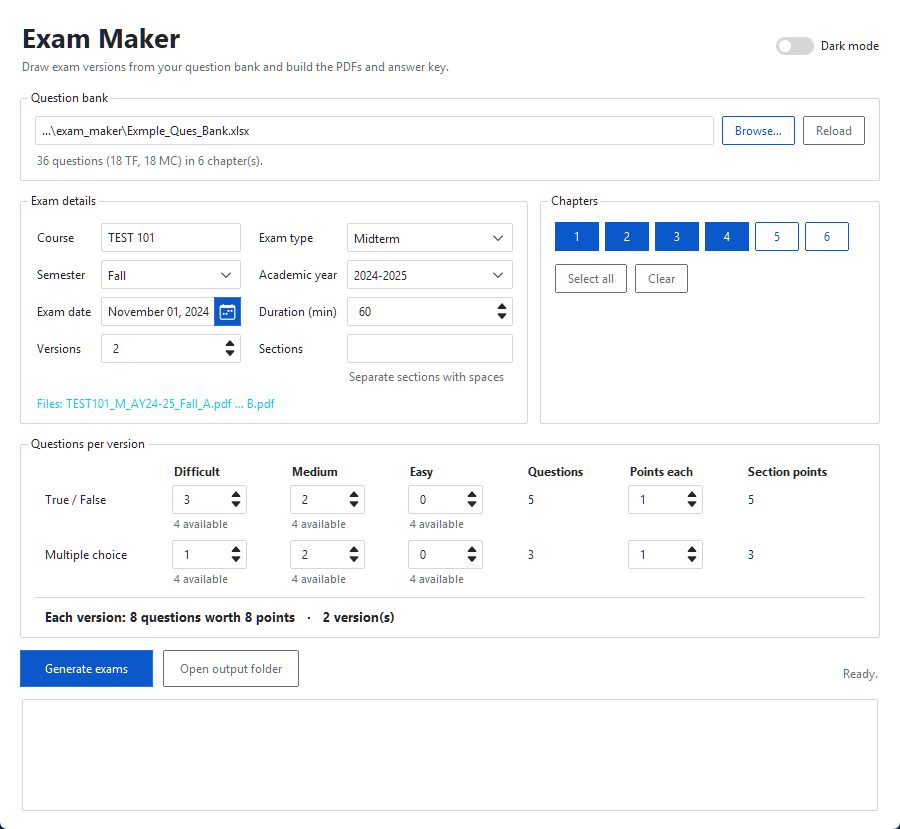
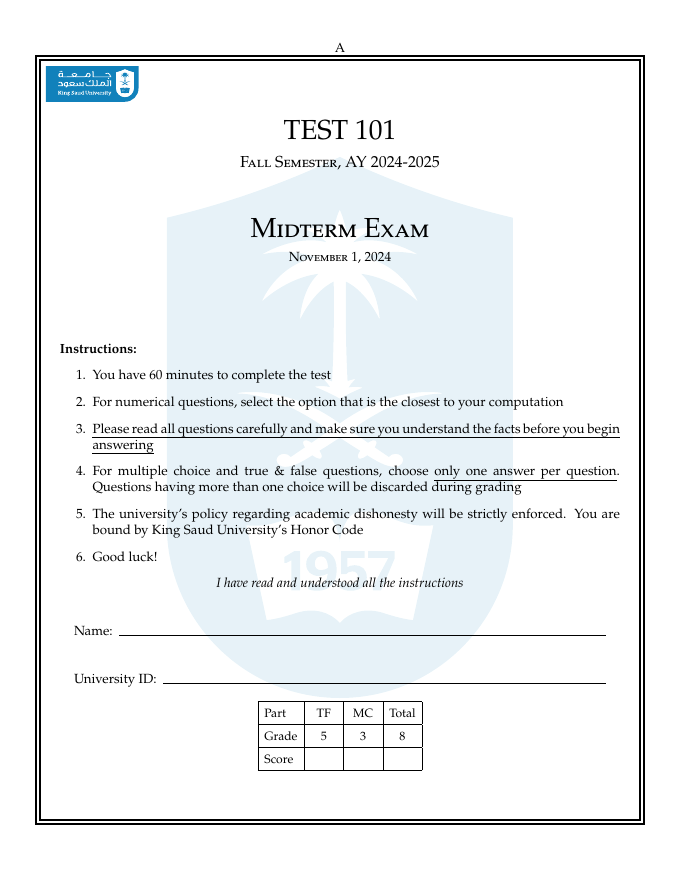
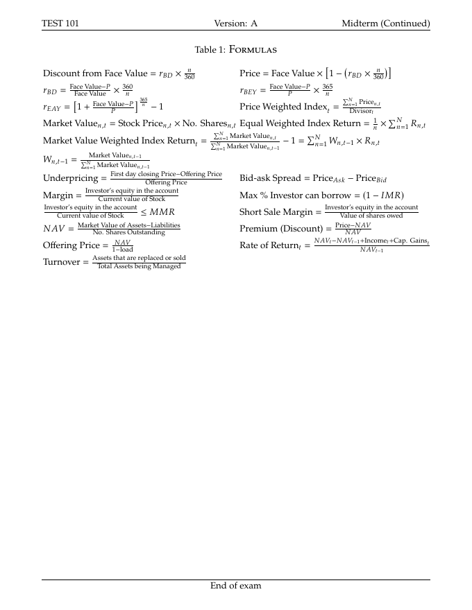

# An Exam Generator Python Script

**Version 3.0** · Dr. Eyad Alhudhaif · King Saud University

This project generates exam documents from a question bank stored in an Excel file. It draws a different set of questions for each version of the exam, writes every version as a LaTeX document, compiles it to PDF and exports an answer key to Excel. The exams consist of Multiple Choice & True/False questions. If you want to add other types of questions, for instance open-ended questions, you can edit the `.tex` file after it is generated and add any content you like.

***The documents are written in LaTeX, so you should be comfortable writing and editing LaTeX: the questions in the bank, the front page and the formula sheets are all LaTeX code. The program compiles the PDFs itself, running LaTeX as many times as needed so the grading table and page numbers are filled in.***

You can configure:

- The number of versions of the exam (up to 26: A, B, C, ...)
- The information on the front page: course number, exam type (Midterm, Midterm 1, Midterm 2 or Final), semester, academic year, exam date, duration in minutes and the class sections
- The chapters to draw questions from
- The *number* of True/False questions per difficulty level (Difficult, Medium, Easy) for each version & the *points per question*
- The *number* of Multiple Choice questions per difficulty level for each version & the *points per question*

## What's new in version 3.0

- A window to set up and generate exams, with a calendar to pick the exam date, a live count of the questions available in the selected chapters, and light/dark themes. It remembers your last settings.
- File names include the academic year and semester (e.g. `FIN363_M_AY26-27_Fall_B.pdf`), so earlier exams are never overwritten.
- The class sections are printed on the front page, with a box for each student to tick.
- The formulas of the selected chapters are combined into one aligned, two-column table at the end of the exam.
- All versions are compiled in parallel, and the PDFs are complete after a single run (no need to recompile for the grading table).
- Fixes: section totals with half points (e.g. 5 × 0.5 = 2.5) are now correct, missing C/D choices no longer stop the program, and LaTeX errors in a question are reported (with the offending line) instead of stopping the run.

## How to use

From the `exam_document` folder, start the window:

    python exam_maker_gui.py

1. Choose the question bank Excel file (**Browse…**). The window shows how many questions and chapters it contains.
2. Fill in the exam details: course, exam type, semester, academic year, exam date (pick it from the calendar), duration, number of versions and the sections (separated by spaces).
3. Select the chapters to draw from.
4. Enter how many questions of each type and difficulty you want per version, and the points per question. Under each box the window shows how many distinct topics are available in the selected chapters, and turns red when you ask for more than that.
5. Press **Generate exams**. The `.tex` and `.pdf` file of every version and the answer key are written to the `exam_document` folder.

Files are named `Course_ExamType_AcademicYear_Semester_Version`, for example `FIN363_M_AY26-27_Fall_B.pdf`, and the answer key `FIN363_M_AY26-27_Fall_answer_key.xlsx`. The window shows the file names before you generate and asks before replacing existing exams.

If you prefer answering the questions in the terminal, run `python exam_maker.py` instead. Both use the same code (`exam_core.py`).

## The question bank

Use `Exmple_Ques_Bank.xlsx` as a template. It needs the columns **Question, A, B, C, D, Answer, Type, Chapter, Topic** and **Difficulty**:

- `Question`, `A`–`D`: the question and its choices, written in LaTeX. True/False questions only use `A` and `B`.
- `Answer`: the letter of the correct choice.
- `Type`: `TF` or `MC`. `Difficulty`: `Difficult`, `Medium` or `Easy`. `Chapter`: a whole number.
- `Topic`: questions on the same topic are alternatives to each other. Each version takes at most one question per topic and type, so the number of distinct topics limits how many questions can be drawn.

## Customizing the documents

- **Front page**: `exam_document/resources/beginning.tex` holds the King Saud University logo, the instructions, the name/ID/section lines and the grading table.
- **Formulas**: `exam_document/resources/formulas/ch<N>.tex`, one file per chapter. Each line is a row of the two-column formula table, written as `$formula$ & $formula$ \\`. A formula that is too wide for half the page can span both columns with `\multicolumn{2}{l}{$formula$} \\`. Chapters without a file (or with an empty one) are left out.
- **Final exams** end with a closing message and the evaluation form `exam_document/resources/eval_form.pdf`.
- Each section's total must be a whole or half number of points (e.g. 5 or 2.5), because that is what the LaTeX `exam` class supports.

## Requirements

- Python 3.10 or above with the packages `pandas`, `numpy`, `openpyxl`, `pylatex` and, for the window, `ttkbootstrap`:

      pip install pandas numpy openpyxl pylatex ttkbootstrap

  I suggest you use a distribution manager for Python. One popular distribution system is [Anaconda](https://www.anaconda.com/). You can read more about it on [Wikipedia](https://en.wikipedia.org/wiki/Anaconda_(Python_distribution)).
- LaTeX software such as [TeX Live](https://www.tug.org/texlive/) or [MiKTeX](https://miktex.org/), with [pdfTeX](https://www.tug.org/applications/pdftex/). If `latexmk` is available it is used; otherwise `pdflatex` is run directly.

## Example

The example documents in the `exam_document` folder were produced with the following settings (the window above shows them):

| Setting | Value |
| --- | --- |
| Question bank | `Exmple_Ques_Bank.xlsx` |
| Course | TEST 101 |
| Exam type | Midterm |
| Semester / Academic year | Fall, 2024-2025 |
| Exam date | November 1, 2024 |
| Duration | 60 minutes |
| Versions | 2 (A and B) |
| Chapters | 1, 2, 3, 4 |
| True/False questions | 5 (3 Difficult, 2 Medium), 1 point each |
| Multiple Choice questions | 3 (1 Difficult, 2 Medium), 1 point each |

This produced:

- [TEST101_M_AY24-25_Fall_A.pdf](exam_document/TEST101_M_AY24-25_Fall_A.pdf) and [TEST101_M_AY24-25_Fall_B.pdf](exam_document/TEST101_M_AY24-25_Fall_B.pdf), with their `.tex` files
- [TEST101_M_AY24-25_Fall_answer_key.xlsx](exam_document/TEST101_M_AY24-25_Fall_answer_key.xlsx)

| Front page | Formula sheet |
| --- | --- |
|  |  |
